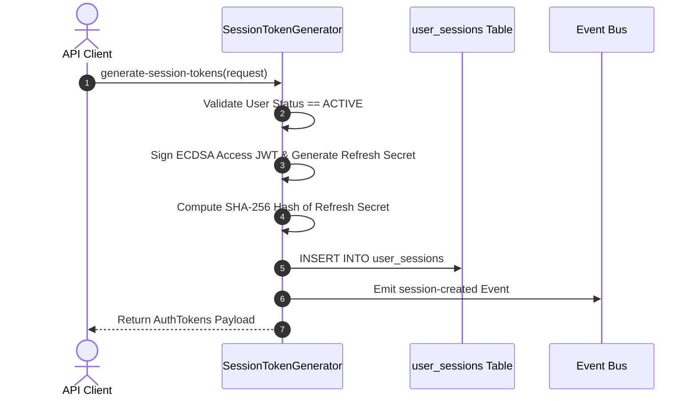

# Session Token Generator

## 1. Intent

The Session Token Generator is a security service responsible for issuing and maintaining user session tokens. It tends to eliminate the security risks of repeatedly sending raw credentials over the network and protect against credential compromise. It achieves this by issuing signed, short-lived access JWTs and managing rotating cryptographic refresh tokens persisted as SHA-256 hashes in storage.

### Story
<a id="story"></a>
As an authenticated user
I want to exchange valid identity credentials for temporary session tokens
So that I can access protected endpoints securely without transmitting plaintext passwords

### Rules
<a id="rules"></a>
- Access tokens MUST be signed and valid for an expiration window of exactly 15 minutes.
- Refresh tokens MUST be cryptographically random 256-bit strings and stored solely as SHA-256 hashes.
- Plaintext refresh tokens MUST NEVER be stored in the database or logged in plaintext output.
- Every token refresh operation MUST rotate the refresh token and invalidate the prior token hash.
- Presentation of an expired or previously rotated refresh token MUST immediately revoke all active sessions for that user.

## 2. Behaviors

### Scenario 1: Initial user session token issuance
<a id="scenario-1"></a>
- Given an authenticated user account exists with status active
- When the client requests session tokens with valid user identification
- Then the system validates the account status
- And the system generates a signed access token and a random refresh token
- And the system persists a new session record into storage
- And the system returns the access and refresh tokens to the client

### Scenario 2: Token refresh rotation
<a id="scenario-2"></a>
- Given an active session exists in storage and its expiration timestamp is in the future
- When the client submits the valid refresh token for renewal
- Then the system validates the token hash against storage
- And the system generates a new access token and a newly rotated refresh token
- And the system updates the session record with the new token hash
- And the system returns the updated token payload to the client

### Scenario 3: Replay attack invalidation
<a id="scenario-3"></a>
- Given a refresh token has already been rotated and replaced with a newer hash
- When a client attempts renewal using the stale or revoked refresh token
- Then the system detects an invalid or already-rotated token signature
- And the system immediately purges all active sessions for that user
- And the system dispatches a security alert event
- And the system returns a token revocation error to the caller

## 3. Tests

### Case 1: Successful initial token generation
<a id="case-1"></a>
- Input([Auth::Session::TokenRequest](#model-1), [Auth::Session::generate-session-tokens](#contract-1)): Valid parameters pointing to active user and client IP.
- Expect([Auth::Session::AuthTokens](#model-2), [Auth::Session::user_sessions](#table-1)): Successful return of tokens payload and inserted session row.

### Case 2: Suspended account token rejection
<a id="case-2"></a>
- Input([Auth::Session::TokenRequest](#model-1), [Auth::Session::SessionStatus](#model-4)): Parameters pointing to a user whose account status is suspended.
- Expect([Auth::Session::TokenResult](#model-5)): Rejection with status 403 and suspended account error payload.

### Case 3: Valid refresh token rotation
<a id="case-3"></a>
- Input([Auth::Session::TokenRefreshRequest](#model-3), [Auth::Session::rotate-session-tokens](#contract-2)): Valid session identifier and unexpired refresh token.
- Expect([Auth::Session::AuthTokens](#model-2), [Auth::Session::user_sessions.refresh_token_hash](#table-1)): Updated auth tokens and rotated hash record in storage.

### Case 4: Replay attack triggering session purge
<a id="case-4"></a>
- Input([Auth::Session::TokenRefreshRequest](#model-3), [Auth::Session::user_sessions](#table-1)): Stale refresh token presented after rotation already occurred.
- Expect([Auth::Session::TokenResult](#model-5), [Auth::Session::user_sessions](#table-1)): Rejection with status 401 and purge of all active user sessions.

### Case 5: Expired refresh token rejection
<a id="case-5"></a>
- Input([Auth::Session::TokenRefreshRequest](#model-3), [Auth::Session::user_sessions.expires_at](#table-1)): Session identifier with expired timestamp.
- Expect([Auth::Session::TokenResult](#model-5)): Rejection with status 401 and session expired error payload.

## 4. Models

### ALDT: `TokenRequest`
<a id="model-1"></a>

| Member | Type | Requirement | Description |
|---|---|---|---|
| `user_id` | `uuid` | required | Unique identity identifier of the authenticated user. |
| `client_ip` | `string` | required | Client network IP address for rate limiting and audit logging. |
| `user_agent` | `string` | optional | Browser or client application footprint string. |
| `remember_me` | `boolean` | optional | Extends session duration from 24 hours to 30 days when set to true. |

### ALDT: `AuthTokens`
<a id="model-2"></a>

| Member | Type | Requirement | Description |
|---|---|---|---|
| `access_token` | `string` | required | Signed asymmetric JWT bearer token string. |
| `refresh_token` | `string` | required | Cryptographically random plaintext refresh token string. |
| `token_type` | `string` | required | Authorization scheme descriptor defaulting to Bearer. |
| `expires_in` | `integer` | required | Access token lifetime duration in seconds. |

### ALDT: `TokenRefreshRequest`
<a id="model-3"></a>

| Member | Type | Requirement | Description |
|---|---|---|---|
| `session_id` | `uuid` | required | Unique identifier of the session record to rotate. |
| `refresh_token` | `string` | required | Plaintext refresh token presented for hash verification. |

### ALDT: `SessionStatus`
<a id="model-4"></a>

| Member | Type | Requirement | Description |
|---|---|---|---|
| `ACTIVE` | `string` | variant | Session is valid and eligible for token refresh operations. |
| `SUSPENDED` | `string` | variant | Session is disabled by administrative lock or policy. |
| `EXPIRED` | `string` | variant | Session has passed its validity window and cannot be refreshed. |

### ALDT: `TokenResult`
<a id="model-5"></a>

| Member | Type | Requirement | Description |
|---|---|---|---|
| `Success` | [Auth::Session::AuthTokens](#model-2) | variant | Successful session issuance or rotation yielding credentials. |
| `Suspended` | `string` | variant | Account suspended error code preventing token generation. |
| `Throttled` | `integer` | variant | Retry interval in seconds when request rate limit is exceeded. |

### ABDT: `SessionStore`
<a id="model-6"></a>

| Operation | Description |
|---|---|
| `SaveSession` | Persists an active session record with its token hash and expiration. |
| `RevokeUserSessions` | Purges all active session records associated with a specific user identifier. |
| `RotateSessionHash` | Atomically replaces an existing session hash and updates expiration timestamp. |

## 5. Contracts

### Contract: `generate-session-tokens`
<a id="contract-1"></a>

```text
generate-session-tokens(request: TokenRequest) -> AuthTokens
```



Parameters:
- `request`([Auth::Session::TokenRequest](#model-1)): Input payload containing user identifier and client network metadata.

Preconditions:
- Assumption([Auth::Session::TokenRequest.user_id](#model-1)): User record exists in persistent storage and account status is active.

Postconditions:
- Guarantee([Auth::Session::user_sessions](#table-1)): A new active session record is inserted into storage.
- Guarantee([Auth::Session::session-created](#protocol-3)): An asynchronous event notification is emitted.

Process:
1. Validate incoming request parameters and verify that the user exists.
2. Confirm that the user account status is not suspended or locked.
3. Generate an asymmetric ECDSA-signed JWT access token valid for 15 minutes.
4. Generate a cryptographically secure random 256-bit refresh token string.
5. Compute the SHA-256 hash of the generated refresh token string.
6. Insert the session record into the user sessions database table.
7. Emit the session-created notification event.
8. Return the AuthTokens structure to the calling client.

Outcomes:
- Success([Auth::Session::AuthTokens](#model-2)): Tokens created and session record inserted into storage.
- Error([Auth::Session::SessionStatus](#model-4)): User account status is suspended.
- Error([Auth::Session::TokenResult](#model-5)): Storage persistence failure or constraint violation.

### Contract: `rotate-session-tokens`
<a id="contract-2"></a>

```text
rotate-session-tokens(request: TokenRefreshRequest) -> AuthTokens
```

Parameters:
- `request`([Auth::Session::TokenRefreshRequest](#model-3)): Input payload containing session identifier and presented refresh secret.

Preconditions:
- Assumption([Auth::Session::user_sessions](#table-1)): Session record matching request identifier exists in active storage.
- Assumption([Auth::Session::user_sessions.expires_at](#table-1)): Session expiration timestamp is greater than current UTC timestamp.

Postconditions:
- Guarantee([Auth::Session::user_sessions.refresh_token_hash](#table-1)): Session record is updated with rotated token hash.

Process:
1. Fetch the existing session record matching request session identifier from storage.
2. Check that the current timestamp has not exceeded the stored expiration timestamp.
3. Compute the SHA-256 hash of the presented refresh token.
4. Compare the computed hash with the refresh token hash in storage.
5. If hashes do not match, purge all sessions for the user and trigger security revocation.
6. Generate a new signed access token and a newly randomized refresh token string.
7. Update refresh token hash and extend expiration timestamp in storage.
8. Return the renewed AuthTokens structure to the calling client.

Outcomes:
- Success([Auth::Session::AuthTokens](#model-2)): Refresh token rotated and new access token issued.
- Error([Auth::Session::TokenResult](#model-5)): Stale or mismatched token presented, triggering session purge.
- Error([Auth::Session::SessionStatus](#model-4)): Current timestamp exceeds stored expiration time.

## 6. Storage

### Table: `user_sessions`
<a id="table-1"></a>

| Field | Type | Nullable | Description |
|---|---|---|---|
| `id` | `uuid` | NOT NULL | Unique primary key identifier for the session record. |
| `user_id` | `uuid` | NOT NULL | Foreign key referencing the owning user account. |
| `refresh_token_hash` | `varchar(64)` | NOT NULL | SHA-256 hexadecimal hash of the active refresh token. |
| `user_agent` | `varchar(512)` | NULL | Client browser user agent string for security audits. |
| `client_ip` | `varchar(45)` | NOT NULL | Client IPv4 or IPv6 network address. |
| `expires_at` | `timestamp` | NOT NULL | UTC expiration timestamp after which the session is invalid. |
| `created_at` | `timestamp` | NOT NULL | UTC creation timestamp when the session was initialized. |
| `updated_at` | `timestamp` | NOT NULL | UTC timestamp when the session token was last rotated. |

- Primary Key: `id`
- Foreign Key: `user_id` references users(`id`)
- Index: `refresh_token_hash`
- Index: `expires_at`

## 7. Protocols

### Protocol: `issue-tokens`
<a id="protocol-1"></a>
- Communication: REST POST /api/v1/auth/tokens
- Sender([Auth::Session::issue-tokens](#protocol-1)): Client application issuing authentication request.
- Receiver([Auth::Session::generate-session-tokens](#contract-1)): Authentication service handling token generation.
- Payload([Auth::Session::TokenRequest](#model-1)): Inbound credentials and client network footprint.
- Errors([Auth::Session::TokenResult](#model-5)): Client error responses 400 and 403.
- Description: Authenticates identity parameters and returns session access and refresh tokens.

### Protocol: `refresh-tokens`
<a id="protocol-2"></a>
- Communication: REST POST /api/v1/auth/tokens/refresh
- Sender([Auth::Session::refresh-tokens](#protocol-2)): Client application requesting token rotation.
- Receiver([Auth::Session::rotate-session-tokens](#contract-2)): Authentication service handling session rotation.
- Payload([Auth::Session::TokenRefreshRequest](#model-3)): Inbound session identifier and refresh secret.
- Errors([Auth::Session::TokenResult](#model-5)): Client error responses 400 and 401.
- Description: Validates refresh token secret and returns renewed access credentials.

### Protocol: `session-created`
<a id="protocol-3"></a>
- Communication: IPC Unix Domain Socket auth.events.socket
- Sender([Auth::Session::generate-session-tokens](#contract-1)): Authentication service emitting session creation event.
- Receiver([Auth::Session::session-created](#protocol-3)): Security audit worker processing event stream.
- Payload([Auth::Session::AuthTokens](#model-2)): Generated session credential payload.
- Errors([Auth::Session::TokenResult](#model-5)): IPC socket disconnect or message transmission failure.
- Description: Broadcasts new session creation events to local security audit workers.
